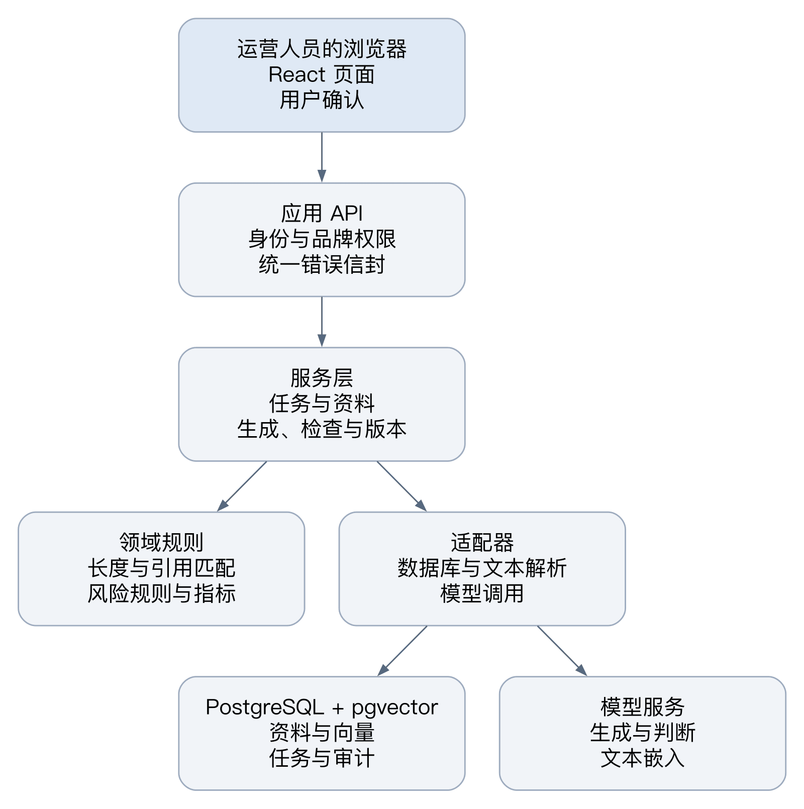
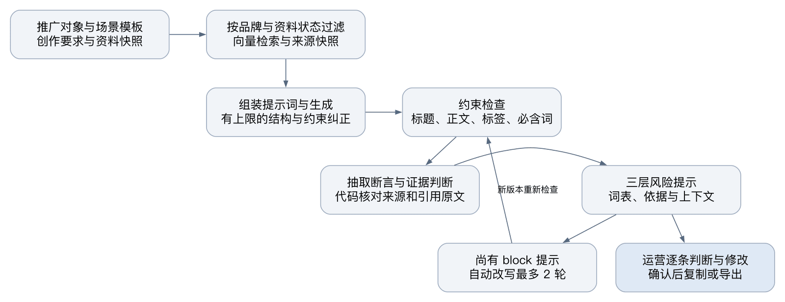
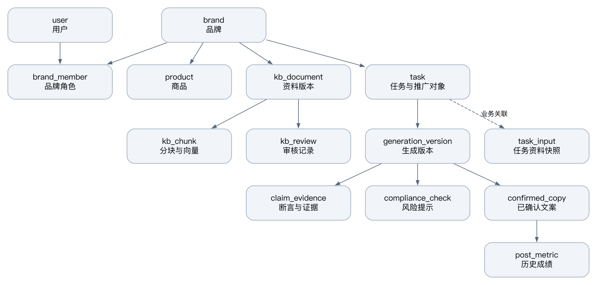

# 小红书美妆香氛文案智能体技术文档

项目名称：RedNoteSearch
文档版本：1.0
完成日期：2026-11-04
代码基线：2029e3b

本文面向使用系统的品牌运营人员、客户技术人员和评审人员。系统以品牌资料起草小红书文字笔记，把引用来源、风险提示和人工决定留在同一份任务记录中。发布由运营人员在小红书完成。

当前交付形态是源码和单机部署配置。已有的模型验证规模小，不能据此推算准确率、并发能力或人力节省。本文把代码已具备的能力与实际验证范围分开记录，统计日期统一为 2026-11-04。

## 1 项目概述

### 1.1 要解决的问题

美妆与香氛文案常同时涉及商品卖点、品牌语气、使用场景和功效说法。运营人员需要判断哪些内容来自品牌资料，哪些只是模型补充，还要保留修改前后的版本。RedNoteSearch 把这些工作放在任务、资料和版本之间建立关联。

运营人员选择品牌和推广对象，指定场景模板，填写创作要求。系统检索本品牌资料，生成标题、正文、话题与封面候选，再检查长度、事实依据和风险词。没有系统依据的事实性断言需要人作出决定，不能直接当作可复制稿交付。

### 1.2 用户与使用场所

平台管理员管理用户与模型连接；品牌管理员维护品牌成员、资料、模板和规则；品牌编辑者创建任务、修改文案并登记成绩。用户的品牌权限保存在服务端，不以页面上选中的品牌作为授权依据。

部署面向一台电脑或一台内网服务器。提供单机 Docker 配置，不包含云端代运维服务。客户部署时仍需决定备份位置、模型服务账号及资料使用范围。

### 1.3 范围与不做的事

| 范围 | 交付边界 |
|---|---|
| 文字笔记 | 生成标题、正文、话题与封面文字，支持运营修改和导出 |
| 平台操作 | 不自动发布，不模拟登录，不翻页采集，不爬取平台数据 |
| 内容形式 | 不生成视频，不处理图片设计，不扩展到其他内容平台 |
| 模型 | 调用外部服务，不训练或微调模型 |
| 专业判断 | 风险提示供人复核，不代替法务终审，不代替商品事实责任人 |
| 部署 | 提供单机部署材料，不交付公网域名、HTTPS 配置或云端运维 |

依据：[接口契约](API_CONTRACT.md)、[部署指南](DEPLOY_QUICKSTART.md)、[插件边界决策](decisions/ADR-014-browser-extension-boundaries.md)。

## 2 功能清单

### 2.1 状态的读法

“已完成”表示基线代码中存在对应接口和页面，并有自动化检查或操作记录；不表示每个环境都已验证。“已完成但样本小或未在真实环境验证”表示能力已接入，但模型效果、平台页面兼容或数据规模仍有缺口。各项验证范围见第 13 章。

### 2.2 基础功能

| 功能与页面 | 能力 | 状态 |
|---|---|---|
| 品牌与成员 `/brands` | 切换品牌，按邮箱添加成员，区分品牌管理员与编辑者 | 已完成 |
| 商品 `/products` | 保存商品、卖点来源、限制宣称；商品种类可自定义，香调按需填写 | 已完成 |
| 品牌档案 `/voice-profile` | 维护品牌口吻、偏好词与禁用词，保留档案版本 | 已完成 |
| 知识库 `/knowledge` | 上传文件、提交临时来源、解析分块；资料审核后建立当前可检索版本 | 已完成 |
| 待审 `/knowledge/review` | 批准、驳回或取消本次审核；相近资料由人选择并存或以新为准 | 已完成但样本小或未在真实环境验证 |
| 场景与类型 `/scenarios`、`/creative-types` | 内置类型加品牌类型；模板版本化，支持删除、恢复和改名另存 | 已完成 |
| 生成 `/generate` | 推广对象支持单品、多品、活动；自定义场景说明并入本次创作要求 | 已完成但样本小或未在真实环境验证 |
| 任务历史 `/tasks` | 按任务查看版本与来源，比较两个版本 | 已完成 |
| 编辑与交付 `/tasks/$taskId/versions/$versionId` | 修改、重新检查、确认后分段复制或导出 Markdown | 已完成 |
| 规则 `/compliance/rules` | 全局与品牌规则分开维护；支持 CSV/JSON 导入、导出、模板下载、批量删除和恢复 | 已完成 |
| 用户设置 `/settings` | 个人资料、密码、平台模型密钥与浏览器插件设置 | 已完成 |

### 2.3 特色功能

| 功能与入口 | 能力 | 状态 |
|---|---|---|
| 任务资料快照 `/generate` | 附加文件或文本只用于当前任务，保留内容与哈希，不自动转入知识库 | 已完成 |
| 约束检查 结果页 | 检查所有标题候选、正文与话题预算、必含词和禁用词 | 已完成 |
| 事实证据 结果页 | 模型提出引用，代码核对来源与原文；人工决定独立记录 | 已完成但样本小或未在真实环境验证 |
| 三层风险提示 结果页 | 词表匹配、功效依据提示和模型上下文提示分别留痕 | 已完成但样本小或未在真实环境验证 |
| 修改清单 结果页 | 将人工修改、指定部分改写和整体要求一次提交，只生成一个子版本并安排一次检查 | 已完成但样本小或未在真实环境验证 |
| 评测 `/evaluation/datasets`、`/evaluation/runs` | 合规、事实核查、生成质量三类；样本编辑生成新版本，运行结果可人工评分 | 已完成但样本小或未在真实环境验证 |
| 爆款结构 `/viral-samples` | 人工粘贴获授权文本，提取结构并转模板；修改样本后标记旧结构 | 已完成但样本小或未在真实环境验证 |
| 品牌串味诊断 评测接口 | 统计竞品词命中，并核对检索分块所属品牌 | 已完成但样本小或未在真实环境验证 |
| 语气推荐 `/generate` | 分组展示品牌已有语气；可请求新候选并排除已展示项 | 已完成但样本小或未在真实环境验证 |
| 成绩 `/results` | 已确认文案登记发布信息、累积读数，提示待补成绩并显示模板使用统计 | 已完成但样本小或未在真实环境验证 |
| 浏览器插件 设置中的插件页 | 用户主动读取当前笔记显示的数字，确认后发送到自己的系统 | 已完成但样本小或未在真实环境验证 |
| 自动发布、爬取、模型微调 | 不提供对应功能 | 不做 |

功能依据分布在 [后端路由](../backend/app/api/routes/)、[前端路由](../frontend/src/routes/)、[文案模块](../frontend/src/lib/zh.ts)。品牌串味诊断没有单独的导航页面，其接口和运行数据结构以契约为准。

## 3 总体架构

### 3.1 组件关系

系统采用模块化单体。浏览器调用同一应用的 API；服务层组织资料、生成、检查与交付。领域规则不依赖 FastAPI 或数据库会话，模型和检索通过端口接入。图 1 展示组件之间的调用方向。



图 1 总体架构

单体并不表示所有逻辑写在同一个模块。API 负责身份、输入与响应；服务层处理事务和流程；领域层处理字符长度、引用匹配、规则与指标；基础设施连接数据库和模型服务。

### 3.2 一次生成的数据流

图 2 从推广对象开始，展示生成与检查的顺序。检索仅使用当前品牌满足状态条件的资料；任务附加资料会单独标明来源等级。



图 2 一次生成的数据流

约束不满足时，不继续把该稿件作为事实检查完成的文案。证据判断与风险提示完成后，如果仍有未处理的 block 提示，生成流水线可自动改写，最多两轮。每轮形成新版本并重新检查。仅缺少证据并不会触发这条自动改写循环。

### 3.3 部署拓扑

图 3 对应 `deploy/compose.yml`。应用镜像同时包含前端静态资源与 API，数据库使用独立容器和持久卷。外部模型服务不在本机容器中。


图 3 单机部署拓扑

默认仅向宿主机映射应用端口 8000。数据库 5432 是容器网络内的端口，交付用 Compose 未把它映射到宿主机。修改网页访问地址时需同时设置 `PUBLIC_URL`，不能只修改浏览器地址。

依据：[模型端口](../backend/app/ports/llm.py)、[生成服务](../backend/app/services/generation.py)、[检查流水线](../backend/app/services/pipeline.py)、[部署配置](../deploy/compose.yml)。

## 4 技术栈与版本

### 4.1 应用依赖

下表为本轮按锁文件安装环境读取的版本，不是包管理器中可用的最新版本。Python 版本另与部署镜像的主次版本区分。

| 层次 | 技术 | 本轮版本或声明 |
|---|---|---|
| 后端运行时 | Python | 本轮 3.14.7；项目要求 ≥3.14 且 <4；镜像标签 `python:3.14` |
| API | FastAPI、Pydantic | 0.141.1、2.13.5 |
| 数据访问 | SQLModel、SQLAlchemy、psycopg | 0.0.47、2.0.51、3.3.6 |
| 迁移 | Alembic | 1.20.0 |
| 密钥加密 | cryptography | 47.0.0 |
| 前端 | React、TypeScript | 19.3.0、6.0.3 |
| 构建与样式 | Vite、Tailwind CSS | 8.3.1、4.3.3 |
| 路由与请求状态 | TanStack Router、TanStack Query | 1.170.39、5.104.0 |
| 客户端生成 | openapi-ts | 0.97.3 |
| 测试 | pytest、Playwright | 9.1.1、1.63.0 |
| 前端检查 | Biome | 2.5.14 |

### 4.2 数据库与模型

| 项目 | 配置与边界 |
|---|---|
| 交付数据库镜像 | `pgvector/pgvector:pg18`，即 PostgreSQL 18 系列；Compose 没有单独固定 pgvector 扩展的数字版本 |
| 本轮测试数据库 | PostgreSQL 17.11，pgvector 扩展 0.8.6；不冒充 pg18 部署环境验证 |
| 向量列 | `vector(1024)`；Python pgvector 包为 0.5.1，不能当作数据库扩展版本 |
| 文本生成 | 当前默认适配器使用 DeepSeek，默认模型名为 `deepseek-flash`；模型清单可由平台管理员配置 |
| 嵌入 | 百炼 `text-embedding-v4`，写入与查询显式使用 1024 维 |
| 价格 | 配置项带价格版本；没有配置时费用为空，不填写猜测价格 |

ADR-006 讨论了其他兼容供应商，但不能把候选供应商写成已经在所有页面完成接入。本交付文档以当前路由工厂和配置中的 DeepSeek、百炼为实际默认路径。

依据：[后端依赖声明](../backend/pyproject.toml)、[前端依赖声明](../frontend/package.json)、[Python 锁文件](../uv.lock)、[前端锁文件](../bun.lock)、[模型决策](decisions/ADR-006-models-and-embeddings.md)、[模型配置](../backend/app/core/config.py)。

## 5 后端设计

### 5.1 分层与适配器

| 层 | 位置 | 责任 |
|---|---|---|
| API | `backend/app/api/routes/` | 校验请求、鉴别用户、取得服务端授权上下文，返回契约响应 |
| 服务 | `backend/app/services/` | 组织用例、执行事务、记录审计、安排后台检查 |
| 领域 | `backend/app/domain/` | 字符口径、引用判断、风险模式、流程状态、评测指标 |
| 端口 | `backend/app/ports/` | 定义 LlmClient、EmbeddingProvider、KnowledgeSearch 等协议 |
| 适配与持久化 | `backend/app/infra/`、`models/` | 外部请求、SQLModel 模型及数据库结构 |

`DbKnowledgeSearch` 把向量查询转换为来源分块。`OpenAICompatibleClient` 处理模型请求、有限重试和调用记录。测试使用内存或脚本化 fake，不需要外部模型返回固定内容。生成后的检查使用 FastAPI BackgroundTasks，没有独立的持久任务队列；服务重启后的任务恢复还需专门验证。

### 5.2 接口分组

所有业务接口前缀为 `/api/v1`。本轮 OpenAPI 有 96 条不同路径，按“HTTP 方法＋路径”统计为 123 个操作。不同方法对同一路径分别计数，不包含静态页面或文档页面。

| 接口组 | 操作数 | 代表用途 |
|---|---|---|
| 登录、用户、辅助与开发专用 | 18 | 登录、用户管理、健康检查；含 development 模式专用接口 |
| 品牌、商品、品牌档案 | 15 | 成员授权、商品资料、品牌档案版本 |
| 知识库 | 12 | 文件与临时来源、审核、相近检查、文本新版本 |
| 任务、场景、创作类型、语气 | 20 | 任务输入与生成、模板、类型及语气候选 |
| 生成版本、证据 | 9 | 编辑、改写、修改清单、确认与导出 |
| 风险规则与提示 | 14 | 规则维护、批量导入导出、提示处理 |
| 评测 | 12 | 数据集、运行、结果、人工评分 |
| 爆款结构 | 9 | 样本、分析结果、转模板 |
| 成绩、插件、模型设置 | 14 | 成绩记录、受限插件入口、网页密钥设置 |

development 专用接口是否纳入统计会改变操作总数，数字口径表单列说明。

### 5.3 错误与请求编号

接口错误统一返回 `error.code`、`message`、`details` 和 `request_id`。同一编号通过 `X-Request-ID` 响应头返回，页面可复制它辅助排查。输入校验错误不回传原始密码等输入值；模型原始响应和堆栈不作为 API 错误正文返回。

| 情况 | HTTP 与错误码示例 | 页面处理 |
|---|---|---|
| 令牌无效或对应用户不存在 | 401 `UNAUTHENTICATED` | 清除会话并回登录页；登录请求本身的错误不触发重复退出 |
| 不是品牌成员或没有管理权限 | 403 `FORBIDDEN` | 显示权限说明 |
| 按资源访问时资源不存在或不属于可访问品牌 | 404 `NOT_FOUND` | 不展示该资源内容 |
| 版本过旧、流程状态不允许 | 409 `INVALID_STATE` | 保留当前文字，提示先处理状态 |
| 模型结构不合法 | 422 `INVALID_MODEL_OUTPUT` | 保留已有版本，显示可重试提示 |
| 模型不可用 | 503 `MODEL_UNAVAILABLE` | 不伪装为生成完成，保留任务与请求编号 |

### 5.4 审计

`audit_log` 保存操作者、品牌、动作、实体和时间。关键动作包括资料审核、规则导入、版本确认、修改清单提交和密钥更新。审计详情使用动作所需的标识与数量；修改要求、文案正文和密钥不作为修改清单审计的正文保存。

模型尝试单独记入 `llm_call_log`，包括用途、模型、token 用量、耗时、价格版本和简短错误。它不是全文提示词存档，也不自动提供已结算的费用。

依据：[授权依赖](../backend/app/api/brand_deps.py)、[错误处理](../backend/app/core/errors.py)、[审计服务](../backend/app/services/audit.py)、[调用记录](../backend/app/services/llm_log.py)。

## 6 数据库设计

### 6.1 主要关系

本轮 SQLModel 元数据定义 32 张表。数据库另有一张 `alembic_version`，空库迁移后物理表数为 33。图 4 仅画主要业务关系；实线连接通过外键关联的表，箭头从父表指向从表；虚线表示由服务层使用标识关联。



图 4 核心表关系

### 6.2 表分组

| 分组 | 表 | 主要作用 |
|---|---|---|
| 组织与权限 | tenant、brand、user、brand_member | 组织、品牌、用户及品牌角色 |
| 商品与档案 | product、brand_voice_profile | 商品事实、来源指针与档案版本 |
| 知识库 | kb_document、kb_chunk、kb_review | 资料版本、向量分块、追加的审核决定 |
| 任务输入 | task_input、task_input_chunk | 不可变资料快照及其检索分块 |
| 场景与任务 | creative_type、scenario_template、style_preset、task | 类型、模板、风格、推广对象与任务 |
| 生成检查 | generation_version、claim_evidence、compliance_check、compliance_rule | 文案版本、断言证据、风险结果及规则 |
| 爆款 | viral_sample、viral_pattern | 人工提供的样本及结构，记录样本修订号 |
| 评测 | eval_dataset、eval_case、eval_run、eval_result、eval_rating | 版本化样本、运行、逐样本结果与评分 |
| 发布成绩 | confirmed_copy、post_metric | 已确认文案、发布信息与历史读数 |
| 安全与记录 | provider_credential、extension_key、audit_log、llm_call_log | 模型凭据、插件密钥摘要、业务与调用记录 |

### 6.3 版本和只增记录

任务资料快照、审核记录、审计记录、模型调用记录和成绩读数按应用路径追加。知识库与文案的文字编辑会创建新版本，旧文字保留。品牌档案与模板也以版本区分当前内容。

这不等于数据库管理员不能改行，也不等于这些表在任何关联删除下永久存在。服务端仍会更新文案的检查状态、人的判断和确认时间；资料状态与当前标记也会变化。因此不能笼统地说“所有业务表只增不改”。

评测样本编辑和删除所选样本会创建新的评测集版本，旧运行仍引用旧样本。爆款样本允许管理员修订，已有结构保留其使用的样本修订号并提示过期，不把旧结构冒充成新内容的分析结果。

### 6.4 向量与迁移

知识库和任务资料均使用 1024 维向量。查询使用余弦距离，并按本品牌、已审核、当前版本、索引就绪和向量非空过滤。任务资料还要匹配任务标识。`product_id` 当前被检索端口接收，但知识库查询没有据此做商品级过滤，见第 14 章。

迁移历史要求保持线性，本轮 `alembic heads` 只有 `d4f8b2c6e0a3`。升级前备份，升级后执行 `alembic check` 确认模型与数据库结构匹配。回滚不能假定对已有数据无损；例如包含新审核动作的记录可能阻止降级。

依据：[模型包](../backend/app/models/)、[迁移目录](../backend/app/alembic/versions/)、[向量检索](../backend/app/services/knowledge_search.py)、[相近审核决策](decisions/ADR-015-knowledge-notes-similarity.md)。

## 7 核心流程

### 7.1 资料进入知识库

文件支持 PDF、DOCX、MD、TXT、CSV。PDF 和 DOCX 上限 50MB，文本文件上限 5MB；没有 OCR，扫描图片不能直接当作可检索文字。解析后分块、计算嵌入，成功入库的当前版本才能用于后续检索。

临时来源要求标题、来源说明和正文。来源说明应交代谁在何时提供了信息；包括管理员在内的提交者都先进入待审。编辑资料创建待审新版本，新版本批准前旧当前版本继续生效。

相近检查只提示内容接近，不判断两份资料是否事实矛盾。它比较本品牌其他组的当前已入库资料，最多使用新资料前 20 块，每块取 5 个近邻，最多展示 10 份。阈值默认 0.90；同标题另列原因，不虚构相似分数。审核人选择并存、以新为准或取消，并填写理由。选择以新为准时，新批准和指定旧资料停用在同一事务提交。

### 7.2 任务与推广对象

单品任务选择一个商品。多品任务由一个主推商品和最多四个搭配商品构成，总计 2～5 个，顺序有意义；卖点在提示词中带商品名称，避免读成另一款的卖点。活动任务不要求商品，填写活动名称、说明与最多十条福利。

活动福利来自运营输入，**系统不替运营核对福利的真实性**。模型新增的优惠说法若没有证据，应进入逐条判断；不能因为输入来自品牌成员就当作知识库证据。

任务可另附最多五份资料，每份不超过 50000 个 Unicode 码点。保存内容与 SHA-256 哈希，来源以后改变不覆盖已有快照。任务资料不自动进入知识库，证据面板以“任务内资料（未审核）”区分。

### 7.3 检索、生成与有上限的纠正

生成服务读取推广对象、场景结构、品牌档案、创作要求及检索来源。当前来源数量上限为 8；提示词只截取来源片段，不把整个品牌库送进生成请求。生成版本保留来源标识、版本、片段哈希、模板版本、提示词版本和模型信息。

模型输出须符合 GeneratedNote 结构。生成最多三轮，即首次加两次约束纠正；每轮结构化输出最多尝试两次。约束仍不满足时状态为 `constraint_failed`，不会无限请求模型。

检查顺序为约束、证据、风险提示。只有仍有未处理 block 风险时，生成流水线才自动改写，最多两轮。自动改写与后面由运营提交的修改清单是两条不同路径。

### 7.4 长度与词语约束

| 项目 | 代码口径 |
|---|---|
| 标题 | 加权长度 ≤20；可打印 ASCII 每字符 0.5，其余每 UTF-16 码元计 1；常见非 BMP emoji 为 2 |
| 正文 | 去掉换行符 `\n` 后计 UTF-16 码元，连同话题可见预算 ≤1000；`\r` 仍计入 |
| 话题 | 最多 10 个；名称去前导井号及首尾空白，每个按井号、名称、分隔空格计入正文 |
| 必含与禁用词 | 检查任务必含词、品牌禁用词与推广商品限制宣称；所有标题候选均检查 |

话题分隔空格的计数采用保守估算，发布页实际识别仍需运营在粘贴后确认。前端字符提示镜像后端算法，服务端结果决定能否确认。

### 7.5 代码核对引用

模型先从标题、正文和话题抽取可核查说法，当前最多保留 12 条。每条检索最多 3 个候选来源，模型返回判断、来源编号和逐字引文。

代码接受“系统判定支持”前，检查来源编号是否在本次候选中，并验证引文是否确实包含在来源里；比较忽略空白与大小写。不存在的来源、空引文或匹配不上的引文降为待人工判断。断言记录保留资料版本、分块或任务快照标识，以及模型理由。

这段代码能挡住虚构来源编号或引用原文不存在的情形，不能证明引文本身可靠，也不能证明引文充分支持了整条断言。抽取遗漏、语义误判和原始资料错误仍可能发生。

### 7.6 三层风险提示

| 层 | 做法 | 判断边界 |
|---|---|---|
| 词表 `lexicon` | 明文或受限制的正则匹配，记录命中位置 | 不能仅凭关键词判断上下文是否合法 |
| 功效依据 `efficacy_basis` | 对功效、医疗或数据说法查证据；有系统支持时可降为 warn | 找到资料不等于该说法在广告中允许使用 |
| 上下文 `context` | 模型识别词表难覆盖的暗示性说法 | 仍受模型漏判和误判影响 |

规则保存来源名称、条款、地区、有效期、严重度和版本。删除在界面中表示停用，可恢复；已有文案中的风险结果不会因规则被停用而消失。导入支持 CSV/JSON 的预览与确认，错误时整份不导入。

block 是确认前必须处理的风险，warn 是提醒。它们是本系统的操作等级，不是法律责任等级。尚未完成来源复核的条目不能伪装成正式条款依据。

### 7.7 人工决定、编辑与重新检查

没有系统支持的断言由运营逐条判为成立或不成立，系统判断与人工决定分开存。人工成立会留下操作者、时间与说明，并以“人工确认（非系统验证）”显示。人工不成立或未决定都会阻止确认，需要修改文字后再检查。

传统编辑接口创建 `edited_pending_recheck` 版本；重新检查针对该版本运行。局部重写也创建新版本，原版本留存。无效模型输出返回 422，不能产生看似成功的半成品版本。

### 7.8 修改清单一次提交

结果页把风险改写、断言处理、直接编辑和整体要求汇成修改清单。`POST /generation-versions/{version_id}/revise` 只接受任务最新版本；旧版本请求返回 409，且不调用模型、不新增版本。

请求可包含 `parts`、`note`、`edited_note`。parts 最多五项，目标为 titles、opening、body、cover、hashtags，同一目标不能重复；每项要求和整体要求分别最多 500 个码点。只有整体要求时，服务端按正文改写处理；只有人工编辑时，不调用生成模型，但后续证据检查仍可能调用模型。

模型部分按清单顺序在内存中处理，全部成功后才写入一个子版本，父标识仍指向用户看到的原版本。随后只安排一次检查，不执行自动改写循环。因此“一次提交”不等于“一次模型调用”。

新版本重新抽取最终文字；只有完全相同的断言原句才能继承已有人工判断，改变的句子不能沿用旧决定。审计只记目标、父版本、是否含人工修改等标记，不记修改要求原文。

### 7.9 确认与导出

确认要求最新版本、最终文字检查完成、约束满足、没有未处理的 block 风险，且所有需要人工判断的断言都已成立。成功后写入选定标题、封面与确认时间，并自动建立已确认文案记录。

`ready_to_copy` 只表示运营确认了这份文字。复制标题、正文和话题分别进行，Markdown 可携带人工核对记录；没有自动发布动作。

依据：[生成服务](../backend/app/services/generation.py)、[约束算法](../backend/app/domain/constraints/length.py)、[引用判断](../backend/app/domain/evidence/judge.py)、[版本服务](../backend/app/services/versions.py)、[修改清单请求](../backend/app/models/revision.py)、[人在回路决策](decisions/ADR-011-human-in-the-loop-evidence.md)。

## 8 防编造与风险治理

### 8.1 已经采取的措施

检索先过滤品牌和资料状态；提示词要求只使用给定事实，禁止补充无来源的使用经历、适用人群、效果、优惠步骤等内容。当前生成提示词为 gen-v7，版本号随稿件保存。

结构校验、字符规则和引用包含关系由代码执行。没有系统依据的断言不会因模型一句“有支持”就直接放行；引用核对不满足条件时，要回到人工决定。最终确认还要检查是不是最新版本以及检查是否针对最终文字运行。

### 8.2 仍然依赖人负责的部分

运营或资料责任人要判断资料来源、有效期和适用范围，确认活动福利及商品事实。模型会漏掉应抽取的说法，也可能拿相关引文支持了不充分的结论。系统没有在每个句子上形式化证明语义正确。

规则的法律来源、等级和适用情境需要维护。词表未命中不意味着没有风险，找到证据也不意味着允许对外宣传。发布前仍需按品牌流程审阅。

### 8.3 追溯的范围

一份文案可追到任务、来源摘要与哈希、资料版本、模板、品牌档案、模型与提示词版本，以及人工判断记录。系统保留足够的标识帮助定位当时依据，但不是电子存证或法律鉴定服务。

## 9 前端设计

### 9.1 页面与导航

文件路由中有 31 个 createFileRoute 声明，扣除一个布局和两个重定向入口后，内容页面为 28 个；包含登录、注册和密码恢复，不把 403/404 公共组件当作独立页面计数。

| 区域 | 路径 |
|---|---|
| 创作 | `/generate`、`/tasks`、`/tasks/$taskId`、`/tasks/$taskId/versions/$versionId`、`/tasks/$taskId/compare` |
| 资料与品牌 | `/brands`、`/products`、`/voice-profile`、`/knowledge`、`/knowledge/$id`、`/knowledge/review` |
| 模板与样本 | `/scenarios`、`/creative-types`、`/viral-samples`、`/viral-samples/$id`、`/viral-patterns/$id` |
| 质量与成绩 | `/results`、`/compliance/rules`、`/evaluation/datasets`、`/evaluation/datasets/$id`、`/evaluation/runs`、`/evaluation/runs/$id` |
| 系统与认证 | `/settings`、`/admin`、`/login`、`/signup`、`/recover-password`、`/reset-password` |

根入口转到生成工作台；旧插件密钥入口转到设置的插件标签。外观切换在侧栏，不是另一张路由页面。

### 9.2 状态与数据获取

TanStack Query 管理请求、缓存、失效与轮询，TanStack Router 管理路由参数。前端使用由 OpenAPI 生成的客户端；枚举文案集中在 `lib/zh.ts`，字符口径在 `lib/count.ts`。401 会触发会话处理，403 不当作密码失效。

| 流程状态 | 界面含义 |
|---|---|
| queued | 任务等待生成 |
| generating | 正在生成 |
| checking | 检查中 |
| constraint_failed | 约束未满足，需要修改 |
| needs_human_review | 需要运营判断断言或处理风险 |
| checks_completed | 检查已完成，尚需运营确认 |
| edited_pending_recheck | 已编辑，等待重新检查 |
| ready_to_copy | 运营已确认，可复制 |

### 9.3 结果页的下一步

“下一步”区域给出当前首要操作和阻止确认的原因。证据与风险卡片显示处理状态，修改要求集中进入清单，减少一边逐条改写、一边丢失其他决定的情况。检查中禁用重复操作；修改清单尚未提交时，不能把屏幕上的草稿当作已检查的版本。

用户可直接改文字，也可选择需要模型处理的部分，最后在修改清单统一提交。历史版本用来查看与比较，不能作为新的统一修改请求的起点。

### 9.4 可访问性与分辨率

页面使用原生按钮或带名称的组件、表单标签、键盘焦点和状态提示；表格操作按行或批量选择。但这些措施不等于完成可访问性认证。

设计基线以桌面为主，常用验证宽度为 1280、1440。375px 下顶栏和资料工具栏的布局仍需验收；不能承诺移动端已覆盖。768px 也只验证过有限页面与状态，不能推及所有弹窗。

依据：[前端路由](../frontend/src/routes/)、[结果页](../frontend/src/routes/_layout/tasks/$taskId/versions/$versionId.tsx)、[文字与枚举](../frontend/src/lib/zh.ts)、[前端视觉决策](decisions/ADR-008-visual-baseline.md)。

## 10 浏览器插件与成绩

### 10.1 读取边界

笔记成绩助手是 Manifest V3 扩展，当前最低 Chrome 版本声明为 110。只在用户点“读取当前页面”时运行一次，读取当前已打开笔记上显示的点赞、收藏、评论以及评论总数。没有后台定时、翻页、平台接口请求或账号模拟登录，不读取评论内容、Cookie 和用户资料。

浮层中可能同时有信息流数字，解析器使用收藏或评论的唯一区域定位；无法确定唯一来源时不猜。评论读数与“共 N 条评论”不符时不直接放行；缩写显示如“2.1万”标为近似，不能改称精确读数。

### 10.2 密钥与连接配置

品牌管理员创建插件密钥，每品牌最多十枚有效密钥。明文只在创建时显示一次，服务端保存 SHA-256 摘要。插件密钥只允许提交成绩，不能用来读取品牌资料或替代用户登录。

连接配置串由页面把系统地址和新密钥编码后生成，方便一次粘贴。编码不是加密，不能公开分享。插件将地址和密钥保存在浏览器本地存储，未加密；丢失时应作废并重发。

系统端仅在密钥所属品牌内按笔记标识匹配已确认文案，丢弃网址查询串，不保存插件传入的完整网址。同一笔记每小时最多接收十二条插件读数。

### 10.3 安装与验证状态

网页插件设置提供安装包下载；包内只含 manifest、parse.js、popup.html、popup.js，用户解压后以开发者模式加载。它不是整套系统的离线安装包。

交接记录记有真实桌面 Chrome 的有限读取、发送、回查、断网与恢复验证；页面分不清时拒读的分支没有在真实页面触发，重复注入相关修复和后续授权保存修复还需要当前版本复测。本轮只执行本地解析测试，不把旧记录写成新版本全量兼容证明。

### 10.4 成绩口径

每次登记都会新增历史读数，不改旧读数。发布满三天，且没有三天之后采集的读数时，显示待补成绩。“最常用”按模板使用篇数统计；“最热”至少要有三篇文案有成绩，按点赞、收藏、评论之和的平均值比较模板，含近似值时标注。

三篇只是显示门槛，不是统计显著性门槛。曝光量、发布时间、投放等因素没有被控制，不能用该排序证明模板导致了更好的传播结果。

依据：[插件代码](../extensions/results-helper/)、[插件说明](EXTENSION.md)、[插件服务](../backend/app/services/extension.py)、[成绩规则](../backend/app/domain/results.py)、[ADR-014](decisions/ADR-014-browser-extension-boundaries.md)。

## 11 安全与数据

### 11.1 身份与品牌授权

登录使用密码校验与 JWT。服务端用用户标识查当前用户；用户不存在时返回 401。前端将 access_token 保存在浏览器 localStorage，当前不是 HttpOnly 会话 Cookie。品牌成员数据通过 BrandAccessDep 取得，品牌管理动作通过相应的管理依赖取得。

平台管理员可管理用户、品牌和成员，但没有成员身份时不能通过普通品牌数据依赖直接读取文案或资料。请求体内自行填写另一个 brand_id 不会获得权限；按资源标识查询时，不存在与不可访问资源都返回 404。

### 11.2 模型密钥

网页“模型与密钥”只向平台管理员开放。DeepSeek 密钥与模型清单、百炼嵌入密钥可在网页设置；接口只返回掩码和来源状态，不回传明文。数据库凭据经 Fernet 加密，加密密钥由 SECRET_KEY 通过 HKDF-SHA256 派生。

取用顺序为网页保存值优先，其次环境变量。清除网页设置会回到环境配置。**备份数据库时须另行保管 SECRET_KEY；更换它会使原密文无法解密，需重新填写网页密钥。**

### 11.3 数据去向

| 数据 | 本机保存或外发范围 |
|---|---|
| 资料正文与分块 | 保存到部署方数据库；解析按文本处理，没有平台抓取 |
| 资料嵌入 | 入库、相近检查、检索会调用嵌入服务，相关文本随该模型请求发往百炼 |
| 文案生成和证据判断 | 请求中的创作要求、相关商品/档案及资料片段会发往配置的模型服务 |
| 爆款样本 | 由用户粘贴；分析时发给模型，不进入知识库检索 |
| 成绩网址与数字 | 用户登记的网址只存储不抓取；插件只主动提交读数和笔记路径信息 |
| 未提交修改清单 | 草稿与修改要求保存在当前浏览器 localStorage，提交后才成为服务器版本；公用终端需考虑本地留存 |
| 密码与服务密钥 | 不作为生成资料；插件本地存储是单独的风险边界 |

网页浏览本身不等于调用生成模型，但上传入库和相近检查也可能产生嵌入请求。客户应按实际启用的供应商审核资料外发范围，不应只在点“生成”时考虑数据出境或外部处理问题。

默认部署未配置 Sentry；若技术人员自行启用错误遥测，还需另行评估日志与追踪信息的去向。资料保留时长、数据库备份权限和终端账号由部署方管理。

### 11.4 需要交付前决定的账号边界

当前代码仍保留 `/signup` 页面及无需登录的 `POST /users/signup`。新账号不会自动成为品牌成员，但这与部署指南里“不开放自助注册”的文字不符。交付前应明确是否允许注册，不能在本文宣称注册已经关闭。

依据：[认证依赖](../backend/app/api/deps.py)、[品牌授权](../backend/app/api/brand_deps.py)、[网页密钥服务](../backend/app/services/provider_keys.py)、[用户路由](../backend/app/api/routes/users.py)、[资料使用决策](decisions/ADR-007-repo-and-client-data.md)。

## 12 部署与运维

### 12.1 单机启动

前提为 Docker Desktop 或 Docker Engine 已可用。源码目录运行下列命令之一：

```powershell
powershell -ExecutionPolicy Bypass -File deploy\start.ps1
```

```bash
bash deploy/start.sh
```

这是脚本提供的启动入口，不表示本轮已在各操作系统实测。Windows、macOS/Linux 新启动脚本均需交付环境验收；历史容器启动记录不能替代新脚本验证。

### 12.2 首次启动

脚本计划在首次运行时建立 `deploy/.env`，生成应用密钥、数据库密码和管理员密码，默认管理员邮箱为 `admin@example.com`。该账号是部署占位值，客户应另行配置实际管理身份；不要把终端显示的密码放入交付文档。

应用等待数据库就绪后运行 `alembic upgrade head` 和初始化。初始化会创建首个管理员、内置场景模板与示例规则；示例规则带来源说明，不能直接当作客户正式规则库。管理员随后在网页填写模型服务密钥，录入品牌和经过审核的资料。

演示数据命令是 `python -m app.seed --fake-embeddings`，只供演示库。当前启动脚本的 Demo 选项调用该命令，却未在交付 Compose 中同步启用 demo_fake；不能把它作为可直接用于真实嵌入的资料库。演示和真实嵌入应使用不同数据库，迁移成真实资料前需重新建立索引并验证。

### 12.3 日常维护与升级

在 `deploy` 目录执行：

| 操作 | 命令 | 数据影响 |
|---|---|---|
| 查看状态 | `docker compose ps` | 只读 |
| 查看应用日志 | `docker compose logs -f app` | 日志须按敏感信息管理 |
| 停止与恢复 | `docker compose stop`、`docker compose start` | 保留数据库卷 |
| 更新应用 | 取得新源码后重新运行启动脚本 | 重新构建；启动时执行待处理迁移 |
| 逻辑备份 | `docker compose exec -T db pg_dump -U postgres app > backup.sql` | 将数据库写到备份文件 |
| 在空库恢复 | `docker compose exec -T db psql -U postgres app < backup.sql` | 需先在隔离空库验证恢复 |

备份建议：由部署方安排周期性数据库备份，另存应用密钥配置，保留升级前副本，并做恢复演练。以上是运维建议，当前代码未提供自动备份调度或跨机灾备。

升级不会主动删除持久卷，但不能因此省略备份。数据库迁移不等于业务资料格式永远兼容。不要把删除数据卷作为升级步骤。

### 12.4 端口、邮件和离线材料

默认网页为 `http://localhost:8000`，APP_PORT 可改宿主机端口，PUBLIC_URL 表示用户实际访问地址。部署配置不自带 HTTPS 终结、域名或公网反向代理，需要技术人员另行设计；不建议直接对公网暴露应用端口。

找回密码需要 SMTP 配置。默认 Compose 没有传入 SMTP 变量，单在 deploy/.env 增加变量还不够，必须由部署人员明确配置传入；本次文档不改部署文件。

整栈离线安装包处于提供中，基线未见完整镜像打包与离线导入脚本。当前首次构建仍需要拉取镜像及依赖。网页可下载的浏览器插件 ZIP 不能替代整栈安装包。

依据：[单机部署配置](../deploy/compose.yml)、[Windows 启动](../deploy/start.ps1)、[macOS/Linux 启动](../deploy/start.sh)、[镜像构建](../backend/Dockerfile)、[初始化脚本](../backend/scripts/prestart.sh)、[部署指南](DEPLOY_QUICKSTART.md)。

## 13 测试与质量

### 13.1 测试分层与本轮结果

| 层次 | 测什么 | 2026-11-04 本轮结果 |
|---|---|---|
| 领域单元 | 长度、词语、引用、流程、指标、导入校验 | 包含在本轮后端全量；领域行覆盖报告 99% |
| 服务与 API | 数据库、权限、品牌隔离、事务、资料版本、修改清单、无效模型输出 | `uv run coverage run -m pytest`：789 项通过，1 项弃用警告 |
| 模型适配器 | 超时、重试、结构校验与调用记录，使用 fake/mock | 包含在 789 项中，没有真实模型调用 |
| 前端端到端用例收集 | Chromium 项目及 setup，含参数化用例 | `playwright test --list --project=chromium`：284 项、31 个文件；仅收集，本轮未全量执行 |
| 插件解析 | 数字缩写、评论核对、浮层、地址与连接配置 | 本轮执行结果见数字口径表 |
| 文档需求条目 | CSV 中的可追溯用例登记 | 334 行；不等同已执行测试数 |

本轮使用独立临时 PostgreSQL 17.11 与 pgvector 0.8.6，未使用录制库。覆盖统计排除迁移版本文件，整体 6926 条语句漏 167 条，报告四舍五入为 98%；领域 1085 条语句漏 5 条，报告为 99%。行覆盖不能换算为准确率。

### 13.2 持续检查

当前持续集成配置包括后端测试与覆盖门槛、迁移单头与空库升级、模型与迁移匹配、向量扩展、前端类型与构建、插件单测、客户端契约、Playwright、敏感信息与用语扫描、工作流安全检查、冲突检查及 Compose 启动测试。

整体覆盖门槛读取 coverage-baseline.txt，当前值为 96；领域门槛为 90。Playwright 只有涉及配置列明的后端、前端等路径变化时才运行；纯文档 PR 可能跳过它。检查配置存在，不等于本次提交所有远端检查已经执行或通过，交付以该提交的检查记录为准。

### 13.3 已有真实模型记录

下表来自交接与决策记录，不是本轮重跑。只列样本规模和观察，不据此计算整体质量或费用。

| 记录与日期 | 样本规模 | 已记录的观察与边界 |
|---|---|---|
| 嵌入接口 2026-10-31 | 1 条短中文输入 | 请求 1024 维并返回 1024 维；未证明检索效果，其他地域地址未验证 |
| 提示词 gen-v3 与 gen-v4 对照 | 每版 4 篇 | 记录中个人经历类表达从 3 篇降至 0 篇；部分商品未支持断言增多，不能写成整体质量提升 |
| 事实核查 2026-11-02 | 12 条，其中有依据与无依据各 6 条 | 记录中有依据说法接受 3/6，无依据或相矛盾说法误接受 0/6；来源映射不是独立人工金标准，不报告系统准确率 |
| 多品与活动提示词 | 多品 1 篇、活动 1 篇 | gen-v6 的活动示例未再编造领取步骤；没有批量质量验证 |
| gen-v7 生成 | 3 款商品各 1 篇 | 未出现该批检查的无来源适用场合与人群说法；每款只有一篇 |
| 爆款结构与转模板 | 一次分析、两次转模板操作 | 路径成功并得到模板版本 1、2；无法推出结构质量或传播效果 |
| 品牌串味诊断 | 2 条诊断样本 | 记录中未见输出竞品词命中和检索品牌串入；规模不足以估计泛化表现 |
| 相近资料阈值 ADR-015 | 7 份资料、14 条输入 | 7 对语序/格式变体余弦相似度 0.944008～0.989761；不同文档同类型只有 1 对，为 0.795506；0.90 仅作初始值 |

记录没有给出统一测量的真实模型总费用，本文不填费用估计。语气生成候选和最新修改清单没有真实模型效果验证记录。

依据：[测试目录](../backend/tests/)、[前端测试](../frontend/tests/)、[用例登记](TEST_CASES.csv)、[持续检查配置](../.github/workflows/)、[交接事实记录](HANDOFF.md)、[ADR-015](decisions/ADR-015-knowledge-notes-similarity.md)。

## 14 已知限制与未验证项

### 14.1 内容和检索

知识库目前按品牌检索，没有按商品对资料做严格隔离；多品任务尤其需要核对卖点归属。代码最多提取十二条断言，不能保证覆盖长文中的每一条事实说法。引用核对只验证引文存在，不能替代语义判断。

规则与模型都可能漏报或误报。功效词需要结合商品类型、注册或备案、宣称评价材料判断；未做系统性的漏报、误报测量。真实模型样本数量有限，没有可用于客户承诺的质量比率。

### 14.2 部署和浏览器

交付用 pg18 镜像与本轮 pg17 数据库不是同一运行环境；本轮没有重跑交付 Compose。新启动脚本在 Windows、macOS/Linux 的实际执行需补验，不能凭代码阅读标为通过。Demo 选项的嵌入模式需要处理后再用于客户演示。

插件依赖页面结构，平台改版可能失效；只有有限的真实 Chrome 记录，没有扩展商店发布或跨浏览器兼容承诺。最新授权保存修复、重复注入修复与拒读分支还需复测。

### 14.3 数据规模与前端

未测并发容量、长时间运行、超大知识库或大量成绩的排序表现。页面以桌面为主，窄屏和辅助技术仍有验收缺口。本轮没有全量重新运行 284 项前端测试，也没有把旧基线的通过结果当作当前结果。

### 14.4 待核对

| 项目 | 当前依据与缺口 | 交付前需要的决定或验证 |
|---|---|---|
| 注册入口 | 代码保留开放注册，部署说明却称不开放 | 明确账号开通方式与访问边界 |
| 启动脚本 | 已有代码，没有本轮实际启动记录 | 分别在交付操作系统和干净 pg18 环境验证 |
| Demo 模式 | 脚本用假嵌入，Compose 默认走真实模式 | 决定演示部署模式并验证索引隔离 |
| 整栈离线包 | 未见可核对的打包产物与导入脚本 | 确定提供的镜像、校验值和安装说明 |
| 最新插件 | 有历史有限验证，最新修复未完整复验 | 用真实 Chrome 复测读取、拒读、发送、失败恢复 |
| 语气和修改清单 | 有自动化用例，未有真实模型效果记录 | 固定小样本验证，不作效果外推 |
| 来源与规则 | 部分来源仍缺逐条复核记录或施行日期 | 由业务与法务责任人补足来源登记 |
| 移动端与可访问性 | 已知窄屏验收缺口，无认证 | 按实际使用设备补验，不扩大交付承诺 |

## 15 后续计划

已讨论的工作是补齐交付环境启动验证、制作离线安装材料、更新演示视频脚本、完成最终页面检查、复测插件，以及在固定小样本上核对语气推荐和修改清单。依赖维护以安全的小版本与补丁更新为主，仍需回归检查。

这些工作不扩展到自动发布、平台采集、模型微调或云端代运维。没有确定的排期和验收结果不在本文承诺完成日期。

## 16 附录

### 16.1 附录 A 决策索引

状态按基线决策文件记录；“已实现，待确认”保留为状态，不把实现等同交付签收。索引仅说明主题，不把开发协作细节带入正文。

| 编号 | 主题 | 状态 |
|---|---|---|
| [ADR-001](decisions/ADR-001-migrations.md) | 线性迁移与单一迁移头 | 已确认 |
| [ADR-002](decisions/ADR-002-coverage.md) | 覆盖率门槛与整体棘轮 | 已确认 |
| [ADR-003](decisions/ADR-003-python-3.14.md) | Python 3.14 | 已确认 |
| [ADR-004](decisions/ADR-004-char-count.md) | 标题与正文字数口径 | 已修订，部分发布页细节待验证 |
| [ADR-005](decisions/ADR-005-copy-format-hashtags.md) | 标题正文话题分别复制 | 已修订 |
| [ADR-006](decisions/ADR-006-models-and-embeddings.md) | 模型适配与嵌入维度 | 已确认，其他候选方案未验证 |
| [ADR-007](decisions/ADR-007-repo-and-client-data.md) | 资料使用与仓库保密 | 已确认 |
| [ADR-008](decisions/ADR-008-visual-baseline.md) | 前端视觉基线 | 已确认 |
| [ADR-009](decisions/ADR-009-main-protection-no-required-review.md) | 主分支保护 | 已确认 |
| [ADR-010](decisions/ADR-010-knowledge-base-tables.md) | 品牌与知识库表结构 | 已实现，原记录待持续检查验证 |
| [ADR-011](decisions/ADR-011-human-in-the-loop-evidence.md) | 人工判断与确认条件 | 已确认并实现 |
| [ADR-012](decisions/ADR-012-backend-ownership-change.md) | 后端职责调整 | 已确认 |
| [ADR-013](decisions/ADR-013-provider-keys-in-web.md) | 网页设置模型密钥 | 已实现，待确认 |
| [ADR-014](decisions/ADR-014-browser-extension-boundaries.md) | 插件只读已打开页面 | 已实现，验证范围有限 |
| [ADR-015](decisions/ADR-015-knowledge-notes-similarity.md) | 临时来源与相近审核 | 已实现并合并，待确认 |

### 16.2 附录 B 术语表

| 术语 | 本文含义 |
|---|---|
| 资料 | 品牌知识库的文件或人工提交的临时来源 |
| 当前版本 | 新任务可使用的资料或模板版本；不等于删去旧版本 |
| 任务资料 | 只附属于某次任务的未审核输入快照 |
| 推广对象 | 单个商品、多商品组合或无具体商品的活动 |
| 创作类型 | 种草等分类键；品牌可增加自己的类型 |
| 场景模板 | 某种类型下的写作结构与指引，带版本 |
| 断言 | 文案中可核查的事实性说法 |
| 系统判定支持 | 模型判断加代码引用匹配所得到的状态，不是事实真实性担保 |
| 人工确认 | 操作者对断言作出决定，独立于系统判断保存 |
| 风险提示 | 规则或模型指出的待审问题，不是法律结论 |
| 修改清单 | 对当前版本累积的人工编辑、部分改写与整体要求 |
| 重新检查 | 对已有或新文字重新运行约束、证据和风险检查 |
| 可复制 | 运营已完成确认；对应 ready_to_copy |
| 已确认文案 | 版本确认后用于登记发布信息与成绩的记录 |
| 成绩读数 | 点赞、收藏、评论在某个采集时间的记录，可标近似 |
| 品牌串味 | 输出出现其他品牌词，或检索返回了其他品牌资料的风险 |
| 假模型 | 测试或演示使用的固定/文本匹配实现，不表示真实模型效果 |

### 16.3 附录 C 环境变量与默认端口

表中只写变量名与非敏感默认值，不给出任何实际凭据。交付 Compose 只传入其 environment 中列明的变量，其他配置不能仅靠写 deploy/.env 自动生效。

| 变量或端口 | 默认值或用途 | 配置位置与注意事项 |
|---|---|---|
| APP_PORT | 8000 | 交付应用宿主端口 |
| PUBLIC_URL | 默认 localhost:8000 | 用户访问地址，映射为 FRONTEND_HOST |
| FRONTEND_HOST | 开发默认 localhost:5173 | CORS 允许来源；交付时由 Compose 覆盖 |
| DATABASE_URL | 无通用默认凭据 | 交付容器指向 db:5432/app |
| SECRET_KEY | 无可公开的值 | JWT 与网页凭据加密根材料，需持久保管 |
| POSTGRES_PASSWORD | 首次脚本随机生成 | 交付数据库密码 |
| FIRST_SUPERUSER | 脚本默认 admin@example.com | 仅占位管理身份，部署时决定实际邮箱 |
| FIRST_SUPERUSER_PASSWORD | 首次脚本随机生成 | 不写入文档或仓库 |
| DEEPSEEK_API_KEY | 可不设 | 网页加密值优先，环境变量为回退 |
| DEEPSEEK_MODEL | deepseek-flash | 默认生成模型 |
| DEEPSEEK_MODELS | 配置中的两个候选模型 | 网页可调整模型清单，不代表每个模型都测过 |
| DASHSCOPE_API_KEY | 可不设 | 百炼嵌入凭据，网页值优先 |
| EMBEDDING_MODEL | text-embedding-v4 | 更换模型需重建索引并验证维度 |
| EMBEDDING_BASE_URL | 百炼国内兼容接口 | 地域须与服务凭据匹配 |
| KB_SIMILARITY_THRESHOLD | 0.90 | 相近审核提示的初始阈值 |
| LLM_TIMEOUT_SECONDS | 60 秒 | 适配器超时设置，不是业务性能承诺 |
| LLM_MAX_RETRIES | 2 | 可重试网络/服务错误的上限，不包括所有业务重试 |
| LLM_MODE | real | demo_fake 仅用于专门的假嵌入演示库 |
| DEEPSEEK_PRICE_IN_PER_1K / OUT_PER_1K | 未设为空 | 单价配置，结合 LLM_PRICE_VERSION 记录 |
| SMTP_HOST / PORT / TLS / SSL | 默认无主机，端口 587 | 邮件需显式传入部署容器；密码不公开 |
| SENTRY_DSN | 未设 | 可选错误遥测，启用前评估数据去向 |
| API 前缀 | /api/v1 | OpenAPI 文档地址为 /api/v1/openapi.json |
| 数据库容器端口 | 5432 | 交付配置不映射宿主机 |
| 前端开发端口 | 5173 | 与交付单容器端口不是同一口径 |

### 16.4 附录 D 文档版本与修订记录

| 版本 | 日期 | 范围 |
|---|---|---|
| 1.0 | 2026-11-04 | 按 2029e3b 建立客户交付版；覆盖统一修改清单、网页密钥、单机部署与明确的未验证项 |

本文件独立于开发协作文档。交付版未纳入人员分工、分支操作规则、提交约定、内部确认讨论和阶段计划；没有改写或替换原协作文档，也没有沿用旧 Word 文档的版本号与统计数字。

### 16.5 数字口径表

下表全部按 2026-11-04、代码基线 2029e3b 统计。覆盖率为工具显示的整数，不能用于推算模型质量。

| 数字 | 数值 | 来源命令或统计口径 |
|---|---|---|
| OpenAPI 不同路径 | 96 | 从 app.openapi() 的 paths 取不同路径数 |
| HTTP 操作 | 123 | paths 下 get/post/put/patch/delete 等方法逐个计数；development 模式含 1 个 private 操作 |
| 非 development 模式操作 | 122 | 读取条件路由代码，从上述集合排除 development 专用 private 操作；未另启生产服务 |
| 业务与支撑表 | 32 | len(SQLModel.metadata.tables)，先完整导入 app.models |
| 临时库物理表 | 33 | information_schema 的 public 基础表；包括 alembic_version |
| 唯一迁移头 | d4f8b2c6e0a3 | uv run alembic heads；只有一个 head |
| 模型与迁移匹配 | 无待生成操作 | uv run alembic check |
| 后端测试 | 789 通过 | uv run coverage run -m pytest；临时 PostgreSQL；假模型 |
| 整体覆盖 | 98% | uv run coverage report；6926 条语句、167 条未覆盖 |
| 领域覆盖 | 99% | uv run coverage report --include="app/domain/*"；1085 条语句、5 条未覆盖 |
| 前端路由声明 | 31 | routes 下 TSX 的 createFileRoute 声明；不计 __root 包装 |
| 前端内容页面 | 28 | 上述集合排除 _layout 布局、根入口重定向、旧插件入口重定向 |
| Playwright 收集 | 284 项，31 文件 | ../node_modules/.bin/playwright test --list --project=chromium；含 setup；未全量执行 |
| 用例登记 | 334 行 | csv.DictReader 读取 TEST_CASES.csv，不含表头 |
| 插件解析单测 | 17 项通过 | node --test extensions/results-helper/test/parse.test.js |
| 依赖版本 | 见第 4 章 | importlib.metadata.version 与已安装前端 package.json，对照锁文件 |

统计步骤需要项目依赖与非敏感环境配置。没有统计吞吐、并发、模型准确率、总体费用或节省的人力；不填推算值。
